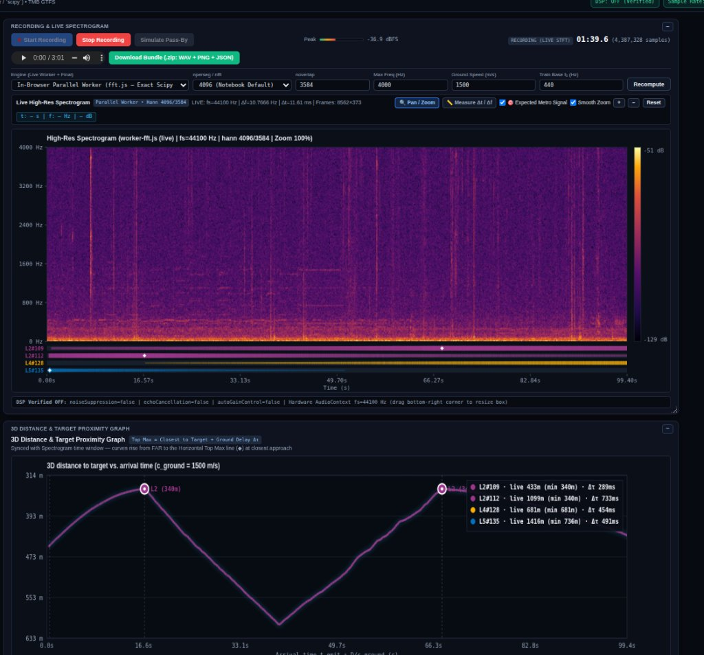
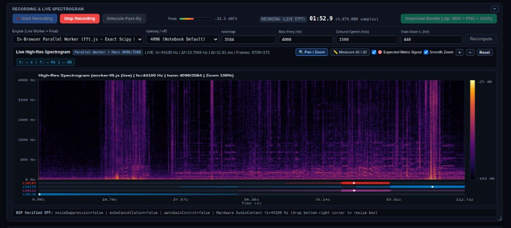
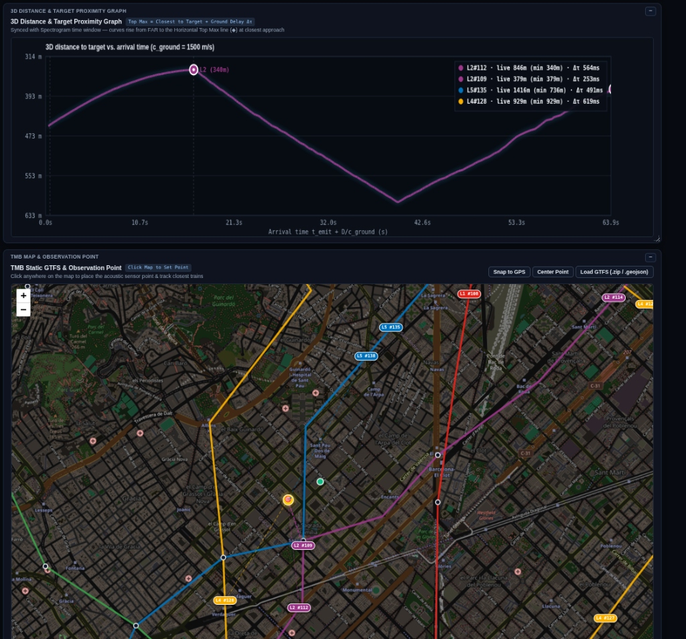
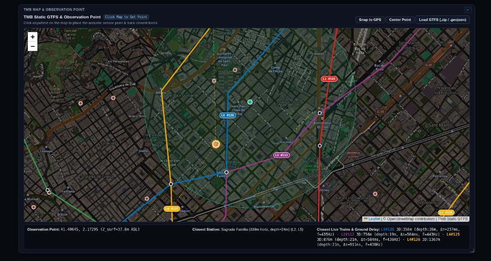

# 🚇 Metro Doppler — Acoustic & GTFS Telemetry

> A client-first hybrid web application combining **raw acoustic capture** (DSP-free), a **real-time parallel high-resolution spectrogram**, **3D ground-delay proximity modelling**, and **live TMB Metro (Barcelona) telemetry**.

🌐 **Live Web App**: [https://carrommad.github.io/metro-doppler/](https://carrommad.github.io/metro-doppler/)

---

## 📸 Screenshots

### 1. Unified Dashboard Overview
Complete synchronized view showing the real-time recording, high-resolution live STFT spectrogram, ground-delayed proximity bars, and the continuous minimum distance graph.



### 2. Live High-Resolution Spectrogram & Timeline
Raw microphone capture running an in-browser Web Worker STFT with custom Hann parameters (`nperseg=4096`, `noverlap=3584`), 2D bilinear smoothing, measurement tool ($\Delta t / \Delta f$ / Doppler velocity), and proximity bars indicating closest train arrivals.



### 3. 3D Distance & Target Proximity Graph
Real-time minimum distance tracking across all surrounding metros accounting for acoustic ground transmission delay ($\Delta \tau = D_{3\text{D}} / c_{\text{ground}}$). Highlights closest points of approach with official line colours and live telemetry readout.



### 4. TMB Metro GTFS Map & Radar Rays
Interactive Leaflet map displaying TMB lines (L1–L5, L9N/S, L10N/S, L11), stations with 3D orography / tunnel depth profiles, animated trains synced via the TMB i-Metro API, and live radar tracking rays from your selected observation point.



---

## ✨ Features

- **Strict Raw Audio Capture**: Disables all browser DSP (`echoCancellation: false`, `noiseSuppression: false`, `autoGainControl: false`) and dynamically identifies the hardware sample rate.
- **Dual STFT Engine**:
  - *Client*: Parallel Web Worker using `fft.js` matching `scipy.signal.spectrogram` parameters in real time.
  - *Server (Optional)*: Python backend (`server.py`) powered by `scipy.signal` for server-side PSD computation.
- **Spectrogram Measurement Tools**: Smooth 2D bilinear pan/zoom, interactive crosshair coordinate readout, and two-point $\Delta t$, $\Delta f$, slope ($df/dt$), and acoustic Doppler speed estimation ($v = c \cdot |\Delta f| / \Sigma f$).
- **Observation Point & 3D Slant Distance**:
  - Click anywhere on the map or drag the `🎯` target pin to set an acoustic observation point.
  - Computes 3D slant distance taking into account surface elevation (ICGC LiDAR digital terrain model) and station/tunnel depths ($D_{3\text{D}} = \sqrt{d_{\text{horiz}}^2 + (Z_{\text{obs}} - Z_{\text{rail}})^2}$).
  - Ground acoustic delay compensation: $\Delta\tau = D_{3\text{D}} / c_{\text{ground}}$ (configurable $c_{\text{ground}}$, default $1500\text{ m/s}$).
- **Single Minimum Distance Curve & Live Legend**: Continuous envelope tracking the closest metro line distance across time, with colored circles marking the closest approaches and a live distance/delay legend.
- **Export Bundle (.zip)**: One-click export bundling the recorded raw audio (`.wav`), high-res spectrogram plot (`.png`), and metadata (`context.json`).
- **Collapsible UI**: All panels (Spectrogram, Proximity Graph, Map) feature a `−` / `+` minimize toggle with persisted layout state in `localStorage`.

---

## 🚀 Quick Start

### Option A: Using the Live Web App
Open [https://carrommad.github.io/metro-doppler/](https://carrommad.github.io/metro-doppler/) in any modern desktop or mobile browser (Chrome, Edge, Firefox, Safari).

### Option B: Running Locally (Standalone / Python Backend)

1. **Clone the repository**:
   ```bash
   git clone https://github.com/carrommad/metro-doppler.git
   cd metro-doppler
   ```

2. **Install Python dependencies** (optional, only required if using the Python `scipy` backend):
   ```bash
   pip install -r requirements.txt
   ```

3. **(Optional) Configure TMB i-Metro Live API**:
   Create a `.env` file in the project root:
   ```env
   TMB_APP_ID=your_tmb_app_id
   TMB_APP_KEY=your_tmb_app_key
   ```
   *(If not provided, the application will use the pre-bundled static GTFS routes and simulated train movement).*

4. **Start the server**:
   ```bash
   python server.py --port 8000
   ```
   Open `http://localhost:8000` in your web browser.

---

## 🛠️ Configuration Parameters

| Parameter | Default | Description |
| :--- | :--- | :--- |
| `nperseg / nfft` | `4096` | STFT window size (samples). |
| `noverlap` | `3584` | Overlap between segments ($87.5\%$). |
| `Max Freq (Hz)` | `4000` | Maximum frequency rendered on the vertical axis. |
| `Ground Speed (m/s)` | `1500` | Acoustic / seismic wave velocity in soil/rock used to calculate $\Delta\tau = D_{3\text{D}} / c_{\text{ground}}$. |
| `Train Base f₀ (Hz)` | `440` | Fundamental emission frequency for Doppler curve projections. |

---

## 📄 License
MIT License. Open Data provided by **TMB (Transports Metropolitans de Barcelona)** and **ICGC (Institut Cartogràfic i Geològic de Catalunya)**.
